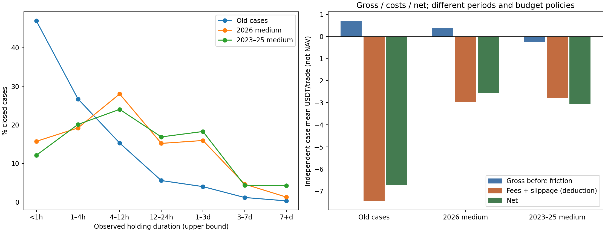

# Среднесрочная Strategy Engine + Anti-Scalp: итоговый отчёт

Все суммы ниже относятся к виртуальному BACKTEST. `trade_entry_allowed=false`.

## A. Почему было 16 333 CLOSED

Это независимые source cases на десяти монетах и шести TF mappings. 8 720 использовали M15/M5; 4 361 H1/M5; 2 086 H4/M5; 728 H1/M15; 389 H4/M15; 49 H4/H1. Каждая идея получала отдельный reference budget, без shared occupancy. Median 65 минут; 7 675 случаев <1h. Сам счётчик не доказывает скальпинг.

## B. Конкретные короткие допущения

`source_permitted._direct`: локальный non-OB мог стать самостоятельной идеей; `_conservative`: micro BOS/new POI; `_emit`: локальный SL и первая FTA mapping; `source_permitted_cases`: полный FTA exit без TP40/30/30/BE и shared notional budget. Max holding, timeout, forced EOF exit и minimum holding отсутствовали. Канонический VirtualPortfolio уже имел TP40/30/30, BE и risk guards; его правила сохранены.

## C. Изменения

Добавлен отдельный MediumTermEngine: H1/H4 ownership, реальный macro context, main structural stop, три distinct pre-known macro targets, immutable physical path selection, корректные causal timestamps. Anti-Scalp проверяет nearest FTA до READY и admission: gross/cost >=3; все четыре costs включены. Порог — инженерная policy, зафиксированная до результатов, не PDF rule. Фиксированных процентных TP и фильтра по будущему holding нет.

Owner flow и owner setup разделены: H1 POI внутри H4 flow инвалидируется по фактическому H1 CLOSE; H4 сохраняет собственную protected thesis. READY IDs/geometry и выбор пути сохранены. На границе primary периода READY из завершённого warmup CLOSE ставится в pending до первого разрешённого OPEN. Risk-blocked unfilled — REJECTED_ADMISSION, а не EOF censoring.

## D. Timeframe roles

D1/H4: context, dealing range, structure/liquidity. H4/H1: setup. H1/M15: refinement. Primary execution clock M15 — реальных M5 в mirror нет. Matched native execution clock M5 — только наблюдение/исполнение, без M5 идей. D1 — полные UTC дни реальных bars, без interpolation.

## E. Lifecycle

DISCOVERED → QUALIFIED → READY → ENTERED → CLOSED/INVALIDATED/EXPIRED. Quotes aliases не создают отдельные trades. OB повторяется только с новой causal reaction; D/S fresh. Исчезновение entry POI/context и потребление target снимают pending quote. Main body/structure/range причина завершает entered idea. Нет timer cooldown/TTL/minimum holding/forced close; OPEN и unfilled end cases censored.

## F. Funnel и количество

Independent-case и shared-account результаты разделены; новая notional cap также влияет на admissibility, поэтому падение count не приписывается одному TF/Anti-Scalp.

| Cohort / account / filter | CLOSED | WIN/LOSS | WR | PF | Exp | Avg R | Gross | Fees | Slip | Net | Mean/median h |
|---|---:|---:|---:|---:|---:|---:|---:|---:|---:|---:|---:|
| Old independent cases / full first FTA | 16333 | 4021/12312 | 24.619% | 0.615 | -6.735 | -0.288 | 11,576.962 | 91,180.156 | 30,393.386 | -109,996.579 | 6.448/1.083 |
| bybit_2023_2025/independent/enabled | 2352 | 818/1534 | 34.779% | 0.776 | -3.041 | -0.130 | -558.927 | 4,944.969 | 1,648.323 | -7,152.220 | 164.133/9.250 |
| bybit_2023_2025/shared/enabled | 880 | 338/542 | 38.409% | 0.742 | -1.228 | -0.130 | -231.839 | 636.801 | 212.267 | -1,080.907 | 25.005/9.500 |
| bybit_2023_2025/independent/disabled_cost_gate | 2351 | 831/1520 | 35.347% | 0.765 | -3.172 | -0.136 | -848.538 | 4,957.268 | 1,652.423 | -7,458.229 | 163.723/8.500 |
| bybit_2023_2025/shared/disabled_cost_gate | 880 | 343/537 | 38.977% | 0.755 | -1.231 | -0.132 | -173.908 | 682.214 | 227.405 | -1,083.526 | 24.792/9.250 |
| native_bybit_2026/independent/enabled | 2270 | 790/1480 | 34.802% | 0.816 | -2.566 | -0.110 | 886.448 | 5,033.974 | 1,677.991 | -5,825.517 | 20.540/7.500 |
| native_bybit_2026/shared/enabled | 396 | 153/243 | 38.636% | 0.834 | -1.677 | -0.088 | 14.811 | 509.270 | 169.757 | -664.215 | 29.347/9.875 |
| native_bybit_2026/independent/disabled_cost_gate | 2259 | 798/1461 | 35.325% | 0.814 | -2.566 | -0.110 | 887.370 | 5,012.562 | 1,670.854 | -5,796.046 | 20.375/7.250 |
| native_bybit_2026/shared/disabled_cost_gate | 398 | 156/242 | 39.196% | 0.827 | -1.698 | -0.092 | -2.417 | 505.094 | 168.365 | -675.876 | 29.106/9.542 |

Primary independent funnel: {"READY": 6760, "FILLED": 2352, "CLOSED": 2352, "shared_FILLED": 880, "shared_CLOSED": 880}

Matched independent funnel: {"READY": 6721, "FILLED": 2281, "CLOSED": 2270, "shared_FILLED": 399, "shared_CLOSED": 396}

Причины до READY (счётчики causal path/reason, не уникальных trades): {"bybit_2023_2025": {"enabled": {"DUPLICATE_CAUSAL_PATH_ALIAS": 4836, "READY": 6760, "REJECTED_SCALP_NO_HTF_CONTEXT": 65790, "REJECTED_SCALP_POOR_EDGE_COST_RATIO": 1042, "REJECTED_SCALP_TARGET_TOO_CLOSE": 660, "WAIT_ACTIVE_MAIN_SOURCE_FLOW": 72435, "WAIT_CAUSAL_RAID_THEN_SOURCE_CONFIRMATION": 20, "WAIT_OB_INSIDE_PREEXISTING_HTF_POI": 109180, "WAIT_PREEXISTING_HIGHER_NATIVE_POI": 1023, "WAIT_RESTING_QUOTE_AND_AHEAD_TARGET": 1279, "WAIT_SOURCE_REQUIRED_PD": 26405, "WAIT_SOURCE_STOP_EVIDENCE": 2, "WAIT_SOURCE_STRUCTURAL_IMPULSE": 120323, "WAIT_THREE_DISTINCT_REAL_MACRO_TARGETS": 862}, "disabled_cost_gate": {"DUPLICATE_CAUSAL_PATH_ALIAS": 4866, "READY": 6796, "REJECTED_SCALP_NO_HTF_CONTEXT": 65690, "WAIT_ACTIVE_MAIN_SOURCE_FLOW": 72382, "WAIT_CAUSAL_RAID_THEN_SOURCE_CONFIRMATION": 17, "WAIT_OB_INSIDE_PREEXISTING_HTF_POI": 109180, "WAIT_PREEXISTING_HIGHER_NATIVE_POI": 1023, "WAIT_RESTING_QUOTE_AND_AHEAD_TARGET": 1391, "WAIT_SOURCE_REQUIRED_PD": 26429, "WAIT_SOURCE_STOP_EVIDENCE": 2, "WAIT_SOURCE_STRUCTURAL_IMPULSE": 120323, "WAIT_THREE_DISTINCT_REAL_MACRO_TARGETS": 927}}, "native_bybit_2026": {"enabled": {"DUPLICATE_CAUSAL_PATH_ALIAS": 4862, "READY": 6721, "REJECTED_SCALP_NO_HTF_CONTEXT": 19765, "REJECTED_SCALP_POOR_EDGE_COST_RATIO": 688, "REJECTED_SCALP_TARGET_TOO_CLOSE": 423, "WAIT_ACTIVE_MAIN_SOURCE_FLOW": 43288, "WAIT_OB_INSIDE_PREEXISTING_HTF_POI": 35129, "WAIT_PREEXISTING_HIGHER_NATIVE_POI": 1218, "WAIT_RESTING_QUOTE_AND_AHEAD_TARGET": 989, "WAIT_SOURCE_REQUIRED_PD": 5158, "WAIT_SOURCE_STOP_EVIDENCE": 5, "WAIT_SOURCE_STRUCTURAL_IMPULSE": 47299, "WAIT_THREE_DISTINCT_REAL_MACRO_TARGETS": 995, "WAIT_CAUSAL_RAID_THEN_SOURCE_CONFIRMATION": 7}, "disabled_cost_gate": {"DUPLICATE_CAUSAL_PATH_ALIAS": 4902, "READY": 6753, "REJECTED_SCALP_NO_HTF_CONTEXT": 19750, "WAIT_ACTIVE_MAIN_SOURCE_FLOW": 43230, "WAIT_OB_INSIDE_PREEXISTING_HTF_POI": 35129, "WAIT_PREEXISTING_HIGHER_NATIVE_POI": 1218, "WAIT_RESTING_QUOTE_AND_AHEAD_TARGET": 1116, "WAIT_SOURCE_REQUIRED_PD": 5209, "WAIT_SOURCE_STOP_EVIDENCE": 5, "WAIT_SOURCE_STRUCTURAL_IMPULSE": 47299, "WAIT_THREE_DISTINCT_REAL_MACRO_TARGETS": 753, "WAIT_CAUSAL_RAID_THEN_SOURCE_CONFIRMATION": 7}}}

Незаполненные READY: {"bybit_2023_2025": {"enabled": {"INVALIDATED": 254, "REJECTED_ADMISSION": 934, "EXPIRED": 3217, "CENSORED_UNFILLED": 3}, "disabled_cost_gate": {"INVALIDATED": 251, "REJECTED_ADMISSION": 939, "EXPIRED": 3252, "CENSORED_UNFILLED": 3}}, "native_bybit_2026": {"enabled": {"INVALIDATED": 132, "REJECTED_ADMISSION": 1045, "EXPIRED": 3257, "CENSORED_UNFILLED": 6}, "disabled_cost_gate": {"INVALIDATED": 134, "REJECTED_ADMISSION": 1040, "EXPIRED": 3303, "CENSORED_UNFILLED": 6}}}

Anti-Scalp rejection counters:

| Cohort / counting basis | Total | NO_HTF_CONTEXT | TARGET_TOO_CLOSE | POOR_EDGE_COST_RATIO |
|---|---:|---:|---:|---:|
| bybit_2023_2025/path/reason decisions | 10716 | 9659 | 366 | 691 |
| bybit_2023_2025/unique ideas never READY / final reason | 3817 | 3680 | 67 | 70 |
| native_bybit_2026/path/reason decisions | 10327 | 9557 | 248 | 522 |
| native_bybit_2026/unique ideas never READY / final reason | 3754 | 3656 | 34 | 64 |

Полные counters и идентификаторы cost-gate exclusions: {"bybit_2023_2025": {"logged_path_reason_decisions": 10716, "unique_physical_opportunities_with_rejection": 4743, "unique_rejected_and_never_READY": 3817, "exclusive_final_reason_counts_never_READY": {"REJECTED_SCALP_NO_HTF_CONTEXT": 3680, "REJECTED_SCALP_POOR_EDGE_COST_RATIO": 70, "REJECTED_SCALP_TARGET_TOO_CLOSE": 67}, "path_reason_counts": {"REJECTED_SCALP_NO_HTF_CONTEXT": 9659, "REJECTED_SCALP_POOR_EDGE_COST_RATIO": 691, "REJECTED_SCALP_TARGET_TOO_CLOSE": 366}, "cost_gate_removed_READY_physical_ids": 36, "cost_gate_removed_READY_ids": ["04b09d25b3ba1db3a72d4885", "09fd4534e59a236702bfc341", "0b39a6f586a795c5780d2c21", "17c0ea3bbdce215f8feadaa7", "216554f71ffea0c9e72d06a7", "259a056684bdb9d679240960", "284be9c8bc90c7b747181b41", "289462d1110322613bd38b56", "31b71045dc12b498b7573f20", "465adc5771dfee1fb2c2669c", "48ffc9e3dbb027af6a915f1c", "63f501e4dc04f70d2eb07b72", "82293d38dc078da1b8854ea1", "86dbf5a0c2dbd66c001320ce", "8e1660c4b1b30894b71ab9ac", "903f5ea73cd16d5c3e39563c", "945ed42c72b360df67cae6b1", "99cfb61e579bc9e0266d5d39", "9ac4fc1f5788973e12c1761e", "9b8214afc13ac6c6fb880f7d", "9d0fa768433bfeaeaee2a434", "9de5cd7dcb97ce4d8d799207", "9f2cd373b01ebb5d65c86da8", "a340310364c2253618fe7ef6", "b8e99c1ecbd2ed25d9167076", "bb0573b6b169549abe36feb7", "bc23f062d3d5bf215ddeed5d", "c6e2e588367776398554a1fd", "cf93d422f89fd961a8e12bf8", "d0863a38200907abd7b75626", "d827407562d685028ea902ac", "dc8c95abad22bc798a044ea3", "f80ab3f0f063ac14f8c6d058", "f90e3ab6e54f148bb99c7806", "f950d251993d9eba8513f224", "f9b36b1545664ffb1bf32b42"], "all_arms_require_valid_medium_setup_and_context": true}, "native_bybit_2026": {"logged_path_reason_decisions": 10327, "unique_physical_opportunities_with_rejection": 4702, "unique_rejected_and_never_READY": 3754, "exclusive_final_reason_counts_never_READY": {"REJECTED_SCALP_TARGET_TOO_CLOSE": 34, "REJECTED_SCALP_NO_HTF_CONTEXT": 3656, "REJECTED_SCALP_POOR_EDGE_COST_RATIO": 64}, "path_reason_counts": {"REJECTED_SCALP_NO_HTF_CONTEXT": 9557, "REJECTED_SCALP_TARGET_TOO_CLOSE": 248, "REJECTED_SCALP_POOR_EDGE_COST_RATIO": 522}, "cost_gate_removed_READY_physical_ids": 32, "cost_gate_removed_READY_ids": ["02b9938945e753c3d22307f3", "0379c17fbf7cf4cd1551303e", "06cd2bce43a333c74300cbfb", "079dac89ab642ba99121db13", "0e27e790754db2729648e4d8", "0e9fdfa0f91b16e982fac387", "24eba2e051a0d8f06c3e0a19", "29c1783659e5be550f194106", "4a6e298d11a9f999e8e514de", "5a26084f44570e90519214dd", "5b8bafbc7835a140a77c2044", "6230abec1198c2f8e230a3ee", "66bc9468c681c256cdfea8d6", "75a9af53c4c8831b520a665f", "796e8046245bef6e06bdb85a", "802c65521c7767c76bdde764", "853c4d5fc678deab9fb1c6fd", "8bbbaf0cb9fd55af4c40af31", "8eb541591afbc60d7ec123bd", "931024558a2d2a50640f4424", "a4f4494d3ab7e73b52d9b10f", "ab58b0715e74a7bfdc477747", "c22f04bb3a23e2dff32ee536", "c52700199baef7d8a8d8936d", "c842d0c4df7bf5e21a4d6f92", "d27ffae72d69d6d2b8b9a7c1", "dd52eb318dbfd43b8139be4a", "eadde932603a5c1df73d7c84", "f1cc63a83730c586bdf4fda2", "f20e69ee583a329e7b64e089", "f6139114b4b576f6a0cca94f", "f82ee6cd578f176b99e6973b"], "all_arms_require_valid_medium_setup_and_context": true}}

Влияние cost gate на полный replay; Net только CLOSED:

| Cohort / account | FILLED OFF → ON | CLOSED OFF → ON | Δ FILLED | Net OFF → ON |
|---|---:|---:|---:|---:|
| bybit_2023_2025/independent | 2351 → 2352 | 2351 → 2352 | +1 | -7,458.229 → -7,152.220 |
| bybit_2023_2025/shared | 880 → 880 | 880 → 880 | +0 | -1,083.526 → -1,080.907 |
| native_bybit_2026/independent | 2270 → 2281 | 2259 → 2270 | +11 | -5,796.046 → -5,825.517 |
| native_bybit_2026/shared | 401 → 399 | 398 → 396 | -2 | -675.876 → -664.215 |

Сопоставление старых коротких cases (gate использовал только READY evidence): {"gate_counts_all_filled": {"ANTI_SCALP_PASSED": 3503, "REJECTED_SCALP_NO_HTF_CONTEXT": 12556, "REJECTED_SCALP_POOR_EDGE_COST_RATIO": 272, "REJECTED_SCALP_TARGET_TOO_CLOSE": 20}, "holding_used_only_after_decision": true, "old_under_1h": {"gate_rejected": 6381, "reason_counts": {"REJECTED_SCALP_NO_HTF_CONTEXT": 6190, "REJECTED_SCALP_POOR_EDGE_COST_RATIO": 175, "REJECTED_SCALP_TARGET_TOO_CLOSE": 16}, "rejected_old_losses": 5441, "total": 7675}, "old_under_4h": {"gate_rejected": 9775, "reason_counts": {"REJECTED_SCALP_NO_HTF_CONTEXT": 9507, "REJECTED_SCALP_POOR_EDGE_COST_RATIO": 248, "REJECTED_SCALP_TARGET_TOO_CLOSE": 20}, "rejected_old_losses": 7830, "total": 12040}, "pre_entry_features_only": true, "total_old_CLOSED": 16333, "total_old_FILLED": 16351, "trade_entry_allowed": false, "uses_old_structural_target_not_new_retargeted_trades": true}

Anti-Scalp ON/OFF сравнивается полным причинным replay. Отказ раннему плохому варианту может дать позже READY другому source-valid пути той же идеи; shared occupancy и margin тоже меняют дальнейшие входы. Поэтому ON не обязан уменьшать FILLED ровно на количество отказов. Logged path reasons, unique physical ideas и unique never-READY приведены раздельно; все arms требуют среднесрочный setup/context.

## G. Holding до/после

Время — верхняя граница от начала entry interval до известного exit CLOSE. entry_time обозначает CLOSE, на котором виртуальный fill стал наблюдаемым; точный intrabar touch OHLC не определяет. OPEN не включены в closed holding. Mean/median/p25/p75/p90/min/max и полный year/month/day breakdown сохранены в medium_term_statistics.json.

Primary shared frequency, включая нулевые дни: {"all_FILLED": 880, "OPEN": 0, "trades_per_year": 300.3983722424502, "trades_per_month": 25.03319768687085, "trades_per_day": 0.8224459198971942, "entries_per_year": 300.3983722424502, "entries_per_month": 25.03319768687085, "entries_per_day": 0.8224459198971942, "total_trades_basis": "CLOSED_ONLY; all_FILLED includes OPEN", "rates_denominator": "SHARED_COMMON_COVERAGE_DAYS_INCLUDING_ZERO_TRADE_DAYS"}

### Старые independent cases

| Holding | n | WR | Gross | Fees | Slip | Net | PF | Exp | Avg R | Planned RR |
|---|---:|---:|---:|---:|---:|---:|---:|---:|---:|---:|
| <1h | 7675 | 13.798% | -62,621.458 | 52,223.831 | 17,407.941 | -132,253.230 | 0.135 | -17.232 | -0.736 | — |
| 1–4h | 4365 | 28.706% | 2,573.096 | 22,707.631 | 7,569.211 | -27,703.746 | 0.618 | -6.347 | -0.271 | — |
| 4–12h | 2497 | 37.205% | 27,152.102 | 10,626.426 | 3,542.143 | 12,983.533 | 1.354 | 5.200 | 0.222 | — |
| 12–24h | 908 | 40.859% | 16,115.938 | 3,203.700 | 1,067.901 | 11,844.338 | 1.943 | 13.044 | 0.557 | — |
| 1–3d | 651 | 44.700% | 19,932.989 | 1,965.604 | 655.202 | 17,312.184 | 3.055 | 26.593 | 1.136 | — |
| 3–7d | 190 | 45.789% | 6,337.475 | 371.103 | 123.701 | 5,842.670 | 3.424 | 30.751 | 1.314 | — |
| 7+d | 47 | 65.957% | 2,086.819 | 81.861 | 27.287 | 1,977.672 | 6.282 | 42.078 | 1.798 | — |

### Matched 2026 medium independent cases

| Holding | n | WR | Gross | Fees | Slip | Net | PF | Exp | Avg R | Planned RR |
|---|---:|---:|---:|---:|---:|---:|---:|---:|---:|---:|
| <1h | 357 | 4.482% | -5,540.940 | 985.437 | 328.479 | -6,854.856 | 0.026 | -19.201 | -0.821 | 5.637 |
| 1–4h | 436 | 9.174% | -6,276.276 | 1,128.622 | 376.207 | -7,781.105 | 0.093 | -17.847 | -0.763 | 4.591 |
| 4–12h | 636 | 33.491% | -2,620.586 | 1,400.385 | 466.795 | -4,487.765 | 0.508 | -7.056 | -0.302 | 3.564 |
| 12–24h | 345 | 53.913% | 3,773.130 | 706.907 | 235.636 | 2,830.587 | 1.820 | 8.205 | 0.351 | 3.007 |
| 1–3d | 362 | 66.851% | 8,288.225 | 643.039 | 214.347 | 7,430.840 | 3.874 | 20.527 | 0.877 | 2.907 |
| 3–7d | 105 | 68.571% | 2,273.950 | 142.805 | 47.602 | 2,083.543 | 4.009 | 19.843 | 0.848 | 2.726 |
| 7+d | 29 | 72.414% | 988.946 | 26.780 | 8.927 | 953.239 | 6.486 | 32.870 | 1.405 | 3.211 |

### Primary 2023–25 medium shared portfolio

| Holding | n | WR | Gross | Fees | Slip | Net | PF | Exp | Avg R | Planned RR |
|---|---:|---:|---:|---:|---:|---:|---:|---:|---:|---:|
| <1h | 106 | 7.547% | -636.740 | 101.060 | 33.687 | -771.487 | 0.010 | -7.278 | -0.836 | 4.858 |
| 1–4h | 180 | 16.667% | -730.934 | 134.285 | 44.762 | -909.981 | 0.143 | -5.055 | -0.691 | 3.775 |
| 4–12h | 207 | 37.681% | -462.556 | 146.983 | 48.994 | -658.534 | 0.362 | -3.181 | -0.323 | 2.865 |
| 12–24h | 152 | 48.026% | 225.634 | 100.057 | 33.352 | 92.224 | 1.153 | 0.607 | 0.078 | 2.964 |
| 1–3d | 168 | 63.095% | 936.648 | 116.589 | 38.863 | 781.197 | 2.612 | 4.650 | 0.571 | 3.026 |
| 3–7d | 47 | 72.340% | 268.596 | 29.887 | 9.962 | 228.747 | 2.514 | 4.867 | 0.666 | 2.696 |
| 7+d | 20 | 45.000% | 167.513 | 7.940 | 2.647 | 156.927 | 2.938 | 7.846 | 1.326 | 3.746 |

Primary holding summary: {"mean": 25.004829545454545, "median": 9.5, "p25": 2.5, "p75": 25.3125, "p90": 59.275000000000006, "min": 0.25, "max": 577.75}

Primary independent holding summary: {"mean": 164.1326530612245, "median": 9.25, "p25": 2.5, "p75": 26.0, "p90": 60.75, "min": 0.25, "max": 10314.25}

В independent cases есть редкие удержания дольше года; они заметно увеличивают среднее относительно медианы. Они сохранены без ретроспективного удаления. Общий счёт исполняет другой набор входов из-за occupancy и risk/margin guards; его распределение приведено отдельно.

## H. Costs

Gross — движение между reference prices до slippage. Канонический ledger gross уже включает slippage; отчёт добавляет его обратно ровно один раз. Gross − fees − slippage = Net проверяется на каждой CLOSED trade. Costs % gross profit uses sum of positive gross-reference trade P&L; undefined ratios are null. Turnover uses actual entry/partial exit fill notionals.

Primary costs: {"gross_pnl": -231.83894809071975, "fees": 636.8008335167012, "slippage": 212.26693523198844, "net_pnl": -1080.9067168394095, "cost_identity_residual": 0.0, "turnover": 1061334.722527835, "total_costs": 849.0677687486897, "costs_percent_gross_profit": 25.02983233945066, "costs_percent_turnover": 0.07999999912623434, "average_cost_per_trade": 0.9648497372144204, "average_gross_move_fraction": -0.0006476780685946632, "average_net_move_fraction": -0.0022484139118403787}

Short <4h / medium ≥4h comparisons доступны для каждого cohort/account/filter. Holding — outcome; корреляция с costs не доказывает, что удержание само вызывает loss. Предвходные target distance, stop width и friction дают причинную интерпретацию.

| Cohort / account / filter | CLOSED | WIN/LOSS | WR | PF | Exp | Avg R | Gross | Fees | Slip | Net | Mean/median h |
|---|---:|---:|---:|---:|---:|---:|---:|---:|---:|---:|---:|
| Old independent/short | 12040 | 2312/9728 | 19.203% | 0.290 | -13.285 | -0.568 | -60,048.362 | 74,931.462 | 24,977.152 | -159,956.976 | 0.976/0.583 |
| Old independent/medium | 4293 | 1709/2584 | 39.809% | 1.827 | 11.638 | 0.497 | 71,625.324 | 16,248.694 | 5,416.234 | 49,960.396 | 21.796/9.917 |
| Matched medium independent/short | 793 | 56/737 | 7.062% | 0.063 | -18.456 | -0.789 | -11,817.217 | 2,114.058 | 704.686 | -14,635.960 | 1.399/1.083 |
| Matched medium independent/medium | 1477 | 734/743 | 49.695% | 1.550 | 5.965 | 0.255 | 12,703.665 | 2,919.915 | 973.306 | 8,810.444 | 30.817/14.417 |
| Primary medium shared/short | 286 | 38/248 | 13.287% | 0.087 | -5.879 | -0.744 | -1,367.674 | 235.345 | 78.448 | -1,681.467 | 1.554/1.250 |
| Primary medium shared/medium | 594 | 300/294 | 50.505% | 1.255 | 1.011 | 0.166 | 1,135.835 | 401.456 | 133.819 | 600.561 | 36.296/18.250 |

## I. Полный новый backtest

Requested 2023-01-01..2026-01-01; actual primary BTC/ETH coverage до 2025-12-05 23:30 UTC, около 2.93 лет. Warmup 2022 не торгуется. Это pinned Bybit mirror: normalized H1/H4 — complete M15 aggregates; сохранены native comparison differences/provenance limits. Другие exchange prices не смешивались. Все данные уже development, OOS/70% WR claim отсутствует.

Primary shared NAV: {"admission_blocks": {"DAILY_LOSS_LIMIT_LATCHED": 17, "ISOLATED_MARGIN_BUDGET": 703, "PREVIOUS_POSITION_STILL_OPEN": 1824}, "average_R": -0.12992932917345448, "average_holding_seconds_known_time_lower_bound": 89117.38636363637, "breakeven_rate": 0.0, "breakevens": 0, "by_direction": {"LONG": {"average_R": -0.10145087082926516, "breakeven_rate": 0.0, "breakevens": 0, "completed_trades": 462, "expectancy": -0.9493975649691884, "gross_loss": 2199.1464243844584, "gross_profit": 1760.5247493686934, "longest_loss_streak": 10, "longest_win_streak": 7, "loss_rate": 0.6017316017316018, "losses": 278, "median_R": -0.9999999999999999, "net_pnl": -438.621675015765, "profit_factor": 0.8005491266282847, "realized_contribution_drawdown_usdt": 531.2890501590205, "undefined_ratio_policy": "NULL_WHEN_NO_TRADES_OR_NO_LOSSES", "win_rate": 0.39826839826839827, "wins": 184}, "SHORT": {"average_R": -0.1614055199749269, "breakeven_rate": 0.0, "breakevens": 0, "completed_trades": 418, "expectancy": -1.5365670857024984, "gross_loss": 1993.742177061683, "gross_profit": 1351.4571352380385, "longest_loss_streak": 10, "longest_win_streak": 7, "loss_rate": 0.631578947368421, "losses": 264, "median_R": -0.9999999999999998, "net_pnl": -642.2850418236444, "profit_factor": 0.6778494986898332, "realized_contribution_drawdown_usdt": 651.551716709141, "undefined_ratio_policy": "NULL_WHEN_NO_TRADES_OR_NO_LOSSES", "win_rate": 0.3684210526315789, "wins": 154}}, "by_symbol": {"BTCUSDT": {"average_R": -0.11419018640325593, "breakeven_rate": 0.0, "breakevens": 0, "completed_trades": 396, "expectancy": -1.3688324484313685, "gross_loss": 1881.8826879856992, "gross_profit": 1339.8250384068772, "longest_loss_streak": 8, "longest_win_streak": 4, "loss_rate": 0.5883838383838383, "losses": 233, "median_R": -0.7104939774035626, "net_pnl": -542.057649578822, "profit_factor": 0.7119599149089249, "realized_contribution_drawdown_usdt": 567.8505906445173, "undefined_ratio_policy": "NULL_WHEN_NO_TRADES_OR_NO_LOSSES", "win_rate": 0.4116161616161616, "wins": 163}, "ETHUSDT": {"average_R": -0.14280680962179873, "breakeven_rate": 0.0, "breakevens": 0, "completed_trades": 484, "expectancy": -1.113324519133445, "gross_loss": 2311.005913460442, "gross_profit": 1772.1568461998547, "longest_loss_streak": 10, "longest_win_streak": 11, "loss_rate": 0.6384297520661157, "losses": 309, "median_R": -0.9999999999999999, "net_pnl": -538.8490672605874, "profit_factor": 0.7668335402683032, "realized_contribution_drawdown_usdt": 565.8329108069165, "undefined_ratio_policy": "NULL_WHEN_NO_TRADES_OR_NO_LOSSES", "win_rate": 0.3615702479338843, "wins": 175}}, "calmar": -0.6265569032492927, "completed_trades": 880, "daily_return_observations": 1069, "entries": 880, "equity_pnl": -1080.9067168394113, "expectancy": -1.2283030873175107, "exposure_fraction_upper_bound": 0.6673903308086216, "exposure_policy": "UNION_ENTRY_BAR_START_TO_EXIT_INCLUDES_UNKNOWN_PRE_TOUCH_PART_OF_ENTRY_BAR", "fees": 636.8008335167016, "fees_as_percent_gross_edge": null, "final_equity": 89.09328316058861, "gross_edge_before_fees": -444.105883322708, "gross_loss": 4192.888601446141, "gross_profit": 3111.981884606732, "inference_status": "ELIGIBLE_FOR_FURTHER_EDGE_ASSESSMENT", "initial_equity": 1170.0, "long_entries": 462, "longest_loss_streak": 11, "longest_win_streak": 6, "loss_rate": 0.615909090909091, "losses": 542, "max_drawdown_duration_seconds": 91965600.0, "max_drawdown_fraction": 0.9329808668639642, "median_R": -0.9999999999999999, "monte_carlo_status": "ELIGIBLE", "net_pnl": -1080.9067168394095, "open_trades": 0, "payoff_ratio": 1.1901626649572041, "profit_factor": 0.7422047615415776, "ratio_status": "365_DAY_UTC_SAMPLING_ZERO_RISK_FREE_RATE", "ready": 6760, "ready_filled_rate": 0.1301775147928994, "realized_account_balance_pnl": -1080.9067168394113, "realized_contribution_drawdown_usdt": 1118.4071711194697, "setups": 6760, "sharpe": -1.7345148215073223, "short_entries": 418, "slippage_cost": 212.2669352319883, "sortino": -2.4250983966374906, "tp_sl_counts": {"BREAKEVEN_SAME_BAR_CONSERVATIVE": 30, "STOP_FIRST_CONSERVATIVE": 630, "STRUCTURAL_MAIN_PROTECTED_STRUCTURE_BODY_BREAK": 48, "STRUCTURAL_MAIN_RANGE_EXHAUSTED": 15, "STRUCTURAL_MAIN_SFP_BODY_INVALIDATION": 9, "STRUCTURAL_MAIN_SOURCE_POI_BODY_INVALIDATED": 16, "TP1": 327, "TP2": 191, "TP3": 132}, "trade_entry_allowed": false, "trades_per_month": 25.033197686870846, "undefined_ratio_policy": "NULL_WHEN_NO_TRADES_OR_NO_LOSSES", "unrealized_pnl": 0, "win_rate": 0.3840909090909091, "wins": 338}

Primary shared results by direction

| Group (UTC for calendar) | CLOSED | WIN/LOSS | WR | PF | Exp | Avg R | Planned RR | Gross | Fees | Slip | Net |
|---|---:|---:|---:|---:|---:|---:|---:|---:|---:|---:|---:|
| LONG | 462 | 184/278 | 39.827% | 0.801 | -0.949 | -0.101 | 3.074 | -1.627 | 327.746 | 109.249 | -438.622 |
| SHORT | 418 | 154/264 | 36.842% | 0.678 | -1.537 | -0.161 | 3.656 | -230.212 | 309.055 | 103.018 | -642.285 |

Primary shared results by coin

| Group (UTC for calendar) | CLOSED | WIN/LOSS | WR | PF | Exp | Avg R | Planned RR | Gross | Fees | Slip | Net |
|---|---:|---:|---:|---:|---:|---:|---:|---:|---:|---:|---:|
| BTCUSDT | 396 | 163/233 | 41.162% | 0.712 | -1.369 | -0.114 | 2.860 | -159.621 | 286.827 | 95.609 | -542.058 |
| ETHUSDT | 484 | 175/309 | 36.157% | 0.767 | -1.113 | -0.143 | 3.751 | -72.218 | 349.973 | 116.658 | -538.849 |

Primary shared results by setup

| Group (UTC for calendar) | CLOSED | WIN/LOSS | WR | PF | Exp | Avg R | Planned RR | Gross | Fees | Slip | Net |
|---|---:|---:|---:|---:|---:|---:|---:|---:|---:|---:|---:|
| BREAKER_CONSERVATIVE_STOP | 30 | 12/18 | 40.000% | 0.639 | -0.875 | -0.060 | 1.194 | -12.277 | 10.491 | 3.497 | -26.265 |
| DEMAND_SUPPLY | 5 | 2/3 | 40.000% | 1.689 | 2.603 | -0.051 | 3.330 | 18.440 | 4.070 | 1.357 | 13.014 |
| OB_CONSERVATIVE_BOS_POI | 112 | 49/63 | 43.750% | 0.635 | -1.062 | -0.074 | 1.216 | -58.347 | 45.414 | 15.138 | -118.899 |
| OB_DIRECT_FIRST_TEST | 6 | 2/4 | 33.333% | 0.944 | -0.268 | -0.153 | 2.483 | 5.045 | 4.991 | 1.664 | -1.609 |
| RANGE_AGGRESSIVE_EXTERNAL_POI | 91 | 22/69 | 24.176% | 0.829 | -1.076 | -0.076 | 6.293 | -16.111 | 61.323 | 20.441 | -97.875 |
| SFP_BOS_POI | 628 | 246/382 | 39.172% | 0.735 | -1.329 | -0.155 | 3.423 | -160.328 | 505.675 | 168.558 | -834.562 |
| STB_BTS_EDGE | 6 | 5/1 | 83.333% | 0.829 | -0.413 | 0.559 | 2.642 | 2.023 | 3.378 | 1.126 | -2.481 |
| STB_BTS_HALF | 2 | 0/2 | 0.000% | 0.000 | -6.116 | -1.000 | 3.254 | -10.285 | 1.460 | 0.487 | -12.231 |

Primary shared results by actual setup TF / execution clock

| Group (UTC for calendar) | CLOSED | WIN/LOSS | WR | PF | Exp | Avg R | Planned RR | Gross | Fees | Slip | Net |
|---|---:|---:|---:|---:|---:|---:|---:|---:|---:|---:|---:|
| 240/15 | 141 | 58/83 | 41.135% | 0.793 | -0.900 | -0.116 | 2.751 | -20.950 | 79.417 | 26.472 | -126.840 |
| 60/15 | 739 | 280/459 | 37.889% | 0.734 | -1.291 | -0.133 | 3.464 | -210.889 | 557.383 | 185.794 | -954.066 |

Primary shared results by year

| Group (UTC for calendar) | CLOSED | WIN/LOSS | WR | PF | Exp | Avg R | Planned RR | Gross | Fees | Slip | Net |
|---|---:|---:|---:|---:|---:|---:|---:|---:|---:|---:|---:|
| 2023 | 275 | 114/161 | 41.455% | 0.752 | -2.127 | -0.110 | 2.875 | -92.671 | 369.139 | 123.046 | -584.857 |
| 2024 | 330 | 121/209 | 36.667% | 0.715 | -1.192 | -0.151 | 3.425 | -126.500 | 200.066 | 66.689 | -393.254 |
| 2025 | 275 | 103/172 | 37.455% | 0.775 | -0.374 | -0.124 | 3.736 | -12.667 | 67.596 | 22.532 | -102.795 |

Primary shared results by month

| Group (UTC for calendar) | CLOSED | WIN/LOSS | WR | PF | Exp | Avg R | Planned RR | Gross | Fees | Slip | Net |
|---|---:|---:|---:|---:|---:|---:|---:|---:|---:|---:|---:|
| 2023-01 | 24 | 8/16 | 33.333% | 0.719 | -3.806 | -0.149 | 3.399 | -35.721 | 41.713 | 13.904 | -91.339 |
| 2023-02 | 30 | 11/19 | 36.667% | 0.396 | -7.587 | -0.386 | 2.894 | -159.457 | 51.117 | 17.039 | -227.613 |
| 2023-03 | 27 | 9/18 | 33.333% | 0.783 | -2.078 | -0.103 | 3.904 | -10.884 | 33.921 | 11.307 | -56.111 |
| 2023-04 | 25 | 7/18 | 28.000% | 0.272 | -6.972 | -0.484 | 2.931 | -128.133 | 34.630 | 11.543 | -174.306 |
| 2023-05 | 19 | 10/9 | 52.632% | 1.731 | 3.752 | 0.316 | 2.388 | 96.591 | 18.981 | 6.327 | 71.283 |
| 2023-06 | 22 | 9/13 | 40.909% | 0.835 | -1.218 | -0.069 | 2.521 | 7.495 | 25.727 | 8.576 | -26.807 |
| 2023-07 | 16 | 9/7 | 56.250% | 2.065 | 4.372 | 0.324 | 2.168 | 98.158 | 21.158 | 7.053 | 69.947 |
| 2023-08 | 18 | 11/7 | 61.111% | 0.786 | -1.244 | -0.078 | 1.654 | 8.777 | 23.376 | 7.792 | -22.391 |
| 2023-09 | 19 | 9/10 | 47.368% | 0.725 | -1.947 | -0.125 | 2.557 | -4.379 | 24.456 | 8.152 | -36.987 |
| 2023-10 | 19 | 11/8 | 57.895% | 1.315 | 1.621 | 0.124 | 2.391 | 54.929 | 18.091 | 6.030 | 30.808 |
| 2023-11 | 23 | 11/12 | 47.826% | 1.703 | 5.216 | 0.370 | 3.618 | 164.108 | 33.106 | 11.035 | 119.967 |
| 2023-12 | 33 | 9/24 | 27.273% | 0.253 | -7.312 | -0.513 | 3.063 | -184.156 | 42.864 | 14.288 | -241.308 |
| 2024-01 | 33 | 12/21 | 36.364% | 0.671 | -2.268 | -0.195 | 4.074 | -26.828 | 36.014 | 12.005 | -74.848 |
| 2024-02 | 28 | 9/19 | 32.143% | 0.550 | -2.586 | -0.262 | 4.096 | -39.424 | 24.739 | 8.246 | -72.409 |
| 2024-03 | 25 | 9/16 | 36.000% | 0.645 | -1.883 | -0.212 | 4.319 | -25.483 | 16.191 | 5.397 | -47.072 |
| 2024-04 | 38 | 14/24 | 36.842% | 0.432 | -2.083 | -0.289 | 2.800 | -55.223 | 17.936 | 5.979 | -79.138 |
| 2024-05 | 20 | 7/13 | 35.000% | 1.676 | 2.676 | 0.485 | 3.864 | 70.085 | 12.424 | 4.141 | 53.519 |
| 2024-06 | 21 | 10/11 | 47.619% | 1.639 | 2.189 | 0.300 | 2.686 | 65.753 | 14.844 | 4.948 | 45.961 |
| 2024-07 | 33 | 13/20 | 39.394% | 0.636 | -1.563 | -0.193 | 3.536 | -22.804 | 21.574 | 7.191 | -51.569 |
| 2024-08 | 30 | 11/19 | 36.667% | 0.676 | -1.229 | -0.167 | 2.580 | -20.943 | 11.956 | 3.985 | -36.885 |
| 2024-09 | 25 | 12/13 | 48.000% | 0.944 | -0.164 | -0.012 | 2.538 | 10.408 | 10.879 | 3.626 | -4.097 |
| 2024-10 | 27 | 6/21 | 22.222% | 0.198 | -3.131 | -0.559 | 2.425 | -67.047 | 13.115 | 4.372 | -84.534 |
| 2024-11 | 31 | 12/19 | 38.710% | 0.942 | -0.158 | -0.010 | 4.737 | 13.171 | 13.556 | 4.519 | -4.903 |
| 2024-12 | 19 | 6/13 | 31.579% | 0.252 | -1.962 | -0.460 | 3.318 | -28.165 | 6.835 | 2.278 | -37.279 |
| 2025-01 | 25 | 8/17 | 32.000% | 0.688 | -0.703 | -0.177 | 4.380 | -6.702 | 8.162 | 2.721 | -17.584 |
| 2025-02 | 7 | 2/5 | 28.571% | 1.867 | 1.798 | 0.559 | 4.891 | 15.142 | 1.916 | 0.639 | 12.588 |
| 2025-03 | 24 | 9/15 | 37.500% | 1.093 | 0.165 | 0.063 | 3.710 | 11.385 | 5.569 | 1.856 | 3.959 |
| 2025-04 | 30 | 11/19 | 36.667% | 0.808 | -0.418 | -0.102 | 4.227 | -1.067 | 8.603 | 2.868 | -12.538 |
| 2025-05 | 18 | 8/10 | 44.444% | 1.053 | 0.103 | 0.046 | 3.088 | 8.353 | 4.877 | 1.626 | 1.851 |
| 2025-06 | 22 | 8/14 | 36.364% | 0.356 | -1.167 | -0.341 | 3.008 | -17.347 | 6.241 | 2.080 | -25.669 |
| 2025-07 | 28 | 10/18 | 35.714% | 0.896 | -0.187 | -0.043 | 3.266 | 5.595 | 8.129 | 2.710 | -5.244 |
| 2025-08 | 28 | 11/17 | 39.286% | 0.556 | -0.774 | -0.264 | 3.699 | -11.514 | 7.623 | 2.541 | -21.678 |
| 2025-09 | 25 | 8/17 | 32.000% | 0.552 | -0.588 | -0.231 | 3.360 | -6.747 | 5.958 | 1.986 | -14.691 |
| 2025-10 | 27 | 9/18 | 33.333% | 0.488 | -0.665 | -0.311 | 3.866 | -11.295 | 4.998 | 1.666 | -17.958 |
| 2025-11 | 29 | 15/14 | 51.724% | 0.937 | -0.055 | -0.017 | 4.364 | 3.781 | 4.031 | 1.344 | -1.594 |
| 2025-12 | 12 | 4/8 | 33.333% | 0.602 | -0.353 | -0.185 | 2.996 | -2.252 | 1.490 | 0.497 | -4.239 |

Все ENTERED сделки, включая OPEN: `data/reports/medium_term_2026_10_10/analysis/all_trades_*.csv`; source proofs, full journal и fills: `role_corrected_v2/{cohort}/detection` и `simulation`. LONG/SHORT, coin, setup, TF, year/month/day и все holding bins: `analysis/medium_term_statistics.json`. Audit/risk timestamps и календарные groups — UTC; year/month/day groups основаны на entry_interval_start. Человекочитаемые ready/entry/exit и начало entry interval в CSV дополнены Asia/Yekaterinburg (+05). Primary entry coverage: 2023-01-01 05:00..2025-12-06 04:30 +05.

## J. Оставшиеся ограничения

Funding/liquidation/tick intrabar path не моделируются. Cases и shared NAV нельзя складывать. Более длинный holding сам по себе не обещает edge. Старые source-valid losses, отклонённые новой horizon/cost policy, не объявляются задним числом source false positives. Сохранены QA failures и исправления: pending/main lifetime, RANGE terminal timestamp и actual H1 setup ownership. Финальные executions используют role_corrected_v2; native causal_final и primary compiled_primary сохранены как controls. READY reuse проверяет archived code 0b6bd4e, history SHA и все manifests; ускорение меняет только копирование targets и сканирование уже выбранных refinement paths.

Поправки ownership по каждому signal/known_at сохранены в ownership_corrections.jsonl.gz и statistics JSON. Они уточняют момент выхода по исходному body rule и не исключают убыточные входы по будущим результатам. First50 chronological CLOSED — экспорт, не выбор лучшего поднабора; для оценки используется вся доступная история.

Диагностика закрытий primary shared: {"terminal_reasons": {"TP3": 132, "STOP_FIRST_CONSERVATIVE": 630, "STRUCTURAL_MAIN_PROTECTED_STRUCTURE_BODY_BREAK": 48, "BREAKEVEN_SAME_BAR_CONSERVATIVE": 30, "STRUCTURAL_MAIN_RANGE_EXHAUSTED": 15, "STRUCTURAL_MAIN_SOURCE_POI_BODY_INVALIDATED": 16, "STRUCTURAL_MAIN_SFP_BODY_INVALIDATION": 9}, "TP1_reached_closed": 327, "TP3_reached_closed": 132, "holding_is_outcome_only": true}

Диагностика закрытий matched shared: {"terminal_reasons": {"STOP_FIRST_CONSERVATIVE": 263, "TP3": 75, "STRUCTURAL_MAIN_PROTECTED_STRUCTURE_BODY_BREAK": 32, "BREAKEVEN_SAME_BAR_CONSERVATIVE": 6, "STRUCTURAL_MAIN_RANGE_EXHAUSTED": 12, "STRUCTURAL_MAIN_SOURCE_POI_BODY_INVALIDATED": 8}, "TP1_reached_closed": 148, "TP3_reached_closed": 75, "holding_is_outcome_only": true}

edge_cost_ratio измеряет достаточность потенциального хода, но не вероятность достижения target. Source-valid идея может быстро получить SL или structural exit. Эти исходы остаются в оценке, включая короткие losses; новые thresholds по ним не выбирались.

## K. Файлы

`src/crypto_bot/strategy/anti_scalp.py`, `source_medium_term.py`; `src/crypto_bot/research/medium_statistics.py`; config/source_medium_term_policy.json; scripts/run_medium_term_research.py, run_compiled_medium_term.py, replay_medium_role_correction.py, verify_medium_term.py, verify_medium_artifacts.py, verify_medium_execution_parity.py, audit_old_medium_gate.py, report_medium_term.py, build_medium_qa_receipt.py; tests/test_medium_term.py; MEDIUM_TERM_RESEARCH_PROTOCOL.md, MEDIUM_TERM_COMPILATION_PROTOCOL.md, MEDIUM_TERM_ROLE_CORRECTION_PROTOCOL.md и MEDIUM_TERM_SOURCE_RECONSTRUCTION.md. Воспроизводимая настройка среды: scripts/cloud_environment_install.sh и CLOUD_ENVIRONMENT_SETUP.md. Все старые artifacts/tests/reports/history сохранены.

## L. Commit

Исходный код до результатов: c754eb0; эквивалентный compiler: 0b6bd4e; role correction зарегистрирован до corrected P&L: 7ef3605. HEAD при генерации отчёта: e05bc2c1def8b6b8f252e3747446f83cbf4a4cbd; ветка medium-term-source-research. Финальный artifact commit сообщается после sealing. Force push не использовался; main baseline dab8d25 сохранён.

## M. Tests / QA

{
  "LIVE_private_exchange_API_orders": "NOT_USED",
  "artifact_integrity": {
    "baseline": {
      "all_tracked_baseline_blobs_unchanged": 16851,
      "baseline_commit": "dab8d254aaf4babc07659e3d03d14b269445767b",
      "status": "PASS"
    },
    "cohorts": {
      "bybit_2023_2025": {
        "READY": {
          "disabled_cost_gate": 6796,
          "enabled": 6760
        },
        "known_timestamps_checked": 2520489,
        "ledger_counts": {
          "disabled_cost_gate/independent": {
            "CLOSED": 2351,
            "FILLED": 2351,
            "OPEN": 0,
            "cost_identity_residual": -1.8189894035458565e-12
          },
          "disabled_cost_gate/shared": {
            "CLOSED": 880,
            "FILLED": 880,
            "OPEN": 0,
            "cost_identity_residual": 9.094947017729282e-13
          },
          "enabled/independent": {
            "CLOSED": 2352,
            "FILLED": 2352,
            "OPEN": 0,
            "cost_identity_residual": -4.547473508864641e-12
          },
          "enabled/shared": {
            "CLOSED": 880,
            "FILLED": 880,
            "OPEN": 0,
            "cost_identity_residual": 0.0
          }
        }
      },
      "native_bybit_2026": {
        "READY": {
          "disabled_cost_gate": 6753,
          "enabled": 6721
        },
        "known_timestamps_checked": 1049336,
        "ledger_counts": {
          "disabled_cost_gate/independent": {
            "CLOSED": 2259,
            "FILLED": 2270,
            "OPEN": 11,
            "cost_identity_residual": -7.275957614183426e-12
          },
          "disabled_cost_gate/shared": {
            "CLOSED": 398,
            "FILLED": 401,
            "OPEN": 3,
            "cost_identity_residual": 1.1368683772161603e-13
          },
          "enabled/independent": {
            "CLOSED": 2270,
            "FILLED": 2281,
            "OPEN": 11,
            "cost_identity_residual": -1.000444171950221e-11
          },
          "enabled/shared": {
            "CLOSED": 396,
            "FILLED": 399,
            "OPEN": 3,
            "cost_identity_residual": -2.2737367544323206e-13
          }
        }
      }
    },
    "status": "PASS",
    "trade_entry_allowed": false
  },
  "causality_and_baseline": {
    "baseline": {
      "all_tracked_baseline_blobs_unchanged": 16851,
      "baseline_commit": "dab8d254aaf4babc07659e3d03d14b269445767b",
      "status": "PASS"
    },
    "checks": [
      {
        "all_native_TFs_and_complete_D1": true,
        "compiled_decision_equivalence": "PASS",
        "cutoff": "2022-01-21T20:15:00+00:00",
        "future_mutation": "PASS",
        "known_timestamps_checked": 2249,
        "prefix": "PASS",
        "signals_compared": 51
      },
      {
        "all_native_TFs_and_complete_D1": true,
        "compiled_decision_equivalence": "PASS",
        "cutoff": "2022-02-22T02:15:00+00:00",
        "future_mutation": "PASS",
        "known_timestamps_checked": 7987,
        "prefix": "PASS",
        "signals_compared": 154
      },
      {
        "all_native_TFs_and_complete_D1": true,
        "compiled_decision_equivalence": "PASS",
        "cutoff": "2022-03-25T08:15:00+00:00",
        "future_mutation": "PASS",
        "known_timestamps_checked": 13162,
        "prefix": "PASS",
        "signals_compared": 245
      }
    ],
    "trade_entry_allowed": false
  },
  "compile": {
    "log": "qa/compile_delivery_final.log",
    "status": "PASS"
  },
  "complete_shared_BACKTEST_SHADOW_parity": {
    "bybit_2023_2025": {
      "disabled_cost_gate": {
        "FILLED": 880,
        "NAV_rows_compared": 102719,
        "journal_decisions_compared": 287064,
        "status": "PASS",
        "trade_entry_allowed": false
      },
      "enabled": {
        "FILLED": 880,
        "NAV_rows_compared": 102719,
        "journal_decisions_compared": 288328,
        "status": "PASS",
        "trade_entry_allowed": false
      }
    },
    "native_bybit_2026": {
      "disabled_cost_gate": {
        "FILLED": 401,
        "NAV_rows_compared": 69119,
        "journal_decisions_compared": 631307,
        "status": "PASS",
        "trade_entry_allowed": false
      },
      "enabled": {
        "FILLED": 399,
        "NAV_rows_compared": 69119,
        "journal_decisions_compared": 635901,
        "status": "PASS",
        "trade_entry_allowed": false
      }
    }
  },
  "full_unittest": {
    "failed": 0,
    "log": "qa/full_unittest_delivery.log",
    "passed": 573,
    "seconds": 24.147,
    "skipped": 0
  },
  "lint": {
    "changed_files": "PASS",
    "comparison_basis": "code/location/message/file exact match",
    "full_tree": "INHERITED_DIAGNOSTICS",
    "inherited_findings": 555,
    "new_findings": 0
  },
  "mypy": {
    "log": "qa/mypy_role_final.log",
    "source_files": 53,
    "status": "PASS"
  },
  "retained_failed_probes": [
    "qa/prefix_failure",
    "qa/artifact_native_verify.log",
    "qa/artifact_native_verify_retry.log"
  ],
  "safety_tests": "INCLUDED_IN_FULL_UNITTEST",
  "source_model_preregistration": "c754eb0 / 0b6bd4e / 7ef3605",
  "targeted_medium_tests": {
    "log": "qa/targeted_boundary_final.log",
    "passed": 17
  },
  "trade_entry_allowed": false
}

