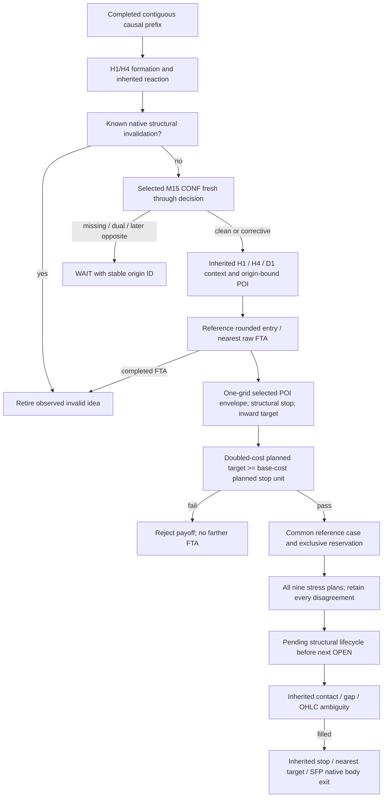

# MACHINE_STRATEGY_v4 deterministic decision tree

Normative nodes are DECISION_TREE.json and the two versioned ENTRY_EXIT/EXECUTION contracts. Missing evidence waits or stops unresolved; it is not structural failure. No outcome column enters any admission node.

At every native M15 interval, execution uses the snapshot known at OPEN; CLOSE/POI changes observed at end apply prospectively to remaining pending orders. H1 is the only new-signal decision clock. Context/POI lifecycle does not create a new exit for filled positions. Deadline is original formation_known_at+57600, executable interval half-open.

Planned payoff ratio N2_s/K_s and eventual financial reporting cash/U are distinct. No actual historical v4 case is evaluated by this document or its synthetic tests.
